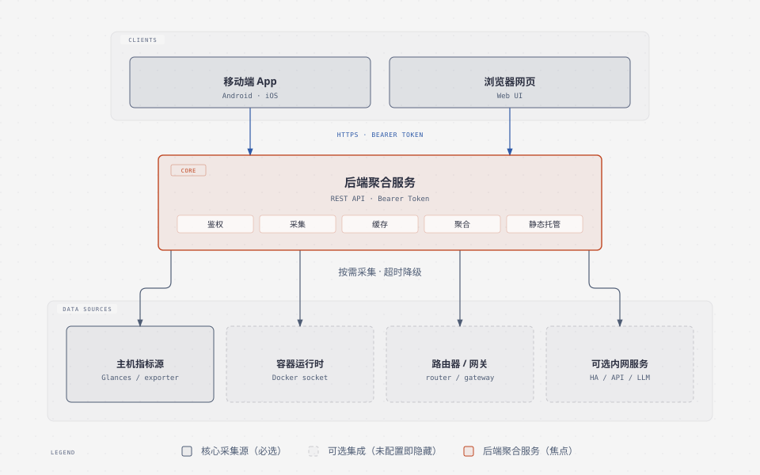

# 自建主机监控与网关面板 —— 需求规格说明书

> **本文档的用途**：交付给接收方的 AI 助手（或开发负责人），用于在其**自己的环境**中重新设计并实现一套等价的监控面板。
>
> **请勿照搬本文档中的任何地址、端口、容器名或服务选型**——它们只是参考实现中的示例。你的任务是基于接收方真实的硬件、网络、系统和服务情况，做一次**环境勘察 → 架构决策 → 分阶段实现 → 验收**。
>
> 本文档描述「要达成什么」，不规定「必须用什么」。技术栈可替换，但**功能契约与接口语义应当对齐**，这样才能复用现有客户端。

---

## 0. 给接收方 AI 的执行指令

在开始写代码之前，请先完成以下动作，不要跳过：

1. **环境勘察**（见 §8.1）：向用户确认主机系统、网络拓扑、已有服务和凭据获取方式。
2. **产出适配方案**（见 §8.2）：写一份「本环境采用哪些监控源、哪些可选集成、部署在哪台机器」的说明，交给用户确认。
3. **分阶段实现**（见 §9）：先做「核心可用」，再做可选集成；每阶段都要能独立跑通。
   - 若需要一份可直接照做的工程骨架，见 §2.4「工程结构与实现骨架」，含目录结构、后端/前端/部署三段可运行的最小实现。
4. **逐条验收**（见 §10）：未实际运行的验证不得标记为通过。

若某项能力在你的环境中没有对应的上游服务，**应当跳过而不是伪造数据**。

---

## 1. 项目定位

一套**私有部署的自建主机监控与网关面板**，把分散在多台机器、多个自建服务上的运行状态，聚合成一个统一视图，并通过手机 App / 网页随时查看。

**核心价值**：
- 一处看全：本机（NAS）、远程服务器、路由器、内网服务的健康与性能。
- 数据自持：所有数据留在自己的机器上，不依赖第三方云。
- 手机可用：通过自建后端 + 客户端 App 实现移动查看与告警。

**典型使用场景**：家庭 / 小型工作室的自建服务器环境，用户希望在不引入商业监控平台的前提下，获得近似「主机 + 容器 + 网关 + 服务」的一体化视图。

---

## 2. 系统架构

### 2.1 分层



> 图中实线框为必选组件，虚线框为按需选配、未配置即整体隐藏的可选集成。可直接编辑的矢量源文件为同目录的 `assets/架构图-需求规格.svg`。

### 2.2 组件职责

| 组件 | 职责 | 是否必需 |
| --- | --- | --- |
| 后端聚合服务 | 采集、聚合、缓存、鉴权、对外提供 REST API；托管静态网页 | 必需 |
| 主机指标源 | 提供 CPU / 内存 / 磁盘 / 网络等原始采集数据 | 必需（可替换实现） |
| 容器运行时接口 | 提供容器列表、状态、资源占用 | 视需求 |
| 客户端 | 展示数据、发起操作、接收告警 | 必需（形态可选） |

### 2.3 部署位置原则

- 后端**必须部署在能够直连所有采集源的主机上**（通常是内网的一台常开主机）。
- 后端与采集源之间尽量走内网；对外只暴露后端这一个入口。
- 客户端通过后端访问一切，**不直连**任何采集源。

### 2.4 工程结构与实现骨架

**交付目标**：接收方 AI 读完本节，应能在其自身环境中搭出「后端可启动 + 网页端可登录看数据」的最小骨架，再按 §4 逐项补齐功能。

#### 2.4.1 目录结构（建议）

```
<repo>/
├── backend/                    # 后端聚合服务
│   ├── app.py                  # 入口：配置校验 + HTTP 服务 + 路由分发
│   ├── config.py               # 所有环境变量集中解析，禁止散落
│   ├── auth.py                 # Bearer Token 校验（常量时间比较）
│   ├── cache.py                # 短周期缓存 + 单飞刷新 + 失败退避
│   ├── api/                    # 路由处理
│   │   ├── health.py           # 免鉴权存活探针
│   │   ├── overview.py         # 总览聚合
│   │   ├── servers.py          # 主机增删改查
│   │   ├── trends.py           # 趋势时序（内存环形缓冲）
│   │   └── containers.py       # 容器列表 / 资源（可选）
│   ├── collectors/             # 每个上游一个采集器，统一接口，可独立失败
│   │   ├── base.py             # Collector 抽象：name / enabled() / collect()
│   │   ├── host_metrics.py     # 主机指标源适配层（必需）
│   │   ├── docker_stats.py     # 容器运行时（可选）
│   │   └── router_gateway.py   # 路由器 / 网关（可选）
│   ├── web/                    # 静态网页端（由后端托管）
│   │   ├── index.html
│   │   ├── app.js
│   │   └── style.css
│   ├── tests/
│   ├── requirements.txt
│   ├── Dockerfile
│   └── .env.example
├── docker-compose.example.yml
└── README.md
```

**关键点**：`web/` 由后端**同源托管**，网页端不需要单独的构建工具链或 Node 环境。「后端起来 = 网页能用」，接收方零前端工程负担。若接收方需要 App，App 与网页端共用同一套 `/api/*`。

#### 2.4.2 后端骨架（可运行的最小实现）

`config.py` —— 环境变量集中解析，无凭据时拒绝启动：

```python
import os

APP_API_TOKEN = os.environ.get("APP_API_TOKEN", "")
WEB_API_TOKEN = os.environ.get("WEB_API_TOKEN", "")
API_PORT = int(os.environ.get("API_PORT", "8765"))
HEALTH_PORT = int(os.environ.get("HEALTH_PORT", "8766"))
UPSTREAM_TIMEOUT = float(os.environ.get("UPSTREAM_TIMEOUT", "4"))
CACHE_TTL = float(os.environ.get("CACHE_TTL", "10"))

# 可选项留空即视为未配置，对应功能整体隐藏
ROUTER_HOST = os.environ.get("ROUTER_HOST", "")

def validate():
    """无 Token 时拒绝启动，而不是放行。"""
    missing = [k for k, v in (("APP_API_TOKEN", APP_API_TOKEN),
                              ("WEB_API_TOKEN", WEB_API_TOKEN)) if len(v) < 24]
    if missing:
        raise SystemExit(f"缺少或过短的必填配置: {', '.join(missing)}")
```

`collectors/base.py` —— 采集器契约，新增上游 = 新增一个类：

```python
class Collector:
    name = "base"

    def enabled(self) -> bool:
        """未配置的上游返回 False，聚合层直接跳过。"""
        return False

    def collect(self) -> dict:
        """成功返回 dict；失败抛异常，由聚合层转为中性状态。"""
        raise NotImplementedError
```

`collectors/host_metrics.py` —— 主机指标适配层（把任意指标源字段映射到统一模型）：

```python
import json, os, urllib.request
import config
from .base import Collector

class HostMetrics(Collector):
    name = "host"

    def __init__(self, host, url):
        self.host, self.url = host, url

    def enabled(self):
        """未配置地址的主机直接跳过，不参与聚合。"""
        return bool(self.url)

    def collect(self):
        """采集失败会抛异常，由 aggregate() 转成 status=down，接口不 5xx。"""
        with urllib.request.urlopen(self.url, timeout=config.UPSTREAM_TIMEOUT) as r:
            raw = json.loads(r.read())
        return {
            "status": "up",
            "name": self.host,
            "metrics": {"cpu": raw.get("cpu"), "memory": raw.get("memory")},
        }

# 用 HOSTS=node1,node2 声明主机，用 <HOST>_METRICS_URL 逐个给出指标源地址
HOSTS = [h.strip() for h in os.environ.get("HOSTS", "").split(",") if h.strip()]
REGISTRY = [
    HostMetrics(h, os.environ.get(f"{h.upper()}_METRICS_URL", ""))
    for h in HOSTS
]
```

`collectors/__init__.py` —— 对外只暴露注册表，聚合层不关心具体采集器：

```python
from .host_metrics import REGISTRY
```

> 换指标源（Glances / node_exporter / netdata / 自研 API）只改 `host_metrics.py` 的字段映射，`app.py` 与网页端都不用动。

`app.py` —— 入口、聚合与降级：

```python
import json, mimetypes, secrets, threading, time
from http.server import BaseHTTPRequestHandler, ThreadingHTTPServer
from pathlib import Path
from urllib.parse import urlparse
import config
from collectors import REGISTRY

WEB_DIR = Path(__file__).resolve().parent / "web"
# 静态文件白名单：只有这些文件可被匿名访问
STATIC_FILES = {"": "index.html", "/": "index.html", "/index.html": "index.html",
                "/app.js": "app.js", "/style.css": "style.css"}

_cache, _lock = {}, threading.Lock()

def aggregate():
    """任何单个采集器失败都不得让接口整体 5xx。"""
    out = {}
    for c in REGISTRY:
        if not c.enabled():
            out[c.name] = {"status": "unconfigured"}
            continue
        try:
            out[c.name] = c.collect()
        except Exception:
            out[c.name] = {"status": "down"}
    return out

def cached_overview():
    now = time.monotonic()
    with _lock:
        hit = _cache.get("overview")
        if hit and now - hit[0] < config.CACHE_TTL:
            return hit[1]
    data = aggregate()
    with _lock:
        _cache["overview"] = (now, data)
    return data

class Handler(BaseHTTPRequestHandler):
    def _authorized(self):
        auth = self.headers.get("Authorization", "")
        if not auth.startswith("Bearer "):
            return False
        supplied = auth[7:].strip()
        return any(v and secrets.compare_digest(supplied, v)
                   for v in (config.APP_API_TOKEN, config.WEB_API_TOKEN))

    def _json(self, obj, code=200):
        body = json.dumps(obj, ensure_ascii=False).encode()
        self.send_response(code)
        self.send_header("Content-Type", "application/json; charset=utf-8")
        self.send_header("Content-Length", str(len(body)))
        self.end_headers()
        self.wfile.write(body)

    def _static(self, path):
        """白名单 + 解析后必须仍在 web/ 内，防目录穿越。静态外壳免鉴权。"""
        name = STATIC_FILES.get(path)
        if not name:
            return False
        target = (WEB_DIR / name).resolve()
        try:
            target.relative_to(WEB_DIR.resolve())
        except ValueError:
            return False
        if not target.is_file():
            return False
        ctype = mimetypes.guess_type(str(target))[0] or "application/octet-stream"
        if ctype.startswith(("text/", "application/javascript")):
            ctype += "; charset=utf-8"      # 静态页含中文，必须声明编码
        body = target.read_bytes()
        self.send_response(200)
        self.send_header("Content-Type", ctype)
        self.send_header("Content-Length", str(len(body)))
        self.end_headers()
        self.wfile.write(body)
        return True

    def do_GET(self):
        path = urlparse(self.path).path
        if self._static(path):          # 网页外壳免鉴权
            return
        if not self._authorized():      # 其余接口一律要求 Token
            return self._json({"error": "unauthorized"}, 401)
        if path == "/api/overview":
            return self._json(cached_overview())
        return self._json({"error": "not found"}, 404)

if __name__ == "__main__":
    config.validate()
    ThreadingHTTPServer(("0.0.0.0", config.API_PORT), Handler).serve_forever()
```

存活探针单独监听一个端口，**免鉴权、不调用任何上游**，供容器 healthcheck 使用：

```python
from http.server import BaseHTTPRequestHandler

class HealthHandler(BaseHTTPRequestHandler):
    def do_GET(self):
        self.send_response(200)
        self.send_header("Content-Type", "text/plain")
        self.end_headers()
        self.wfile.write(b"ok")
```

#### 2.4.3 前端（网页端）布置

网页端是**后端托管的静态单页**，与后端同源：

| 事项 | 做法 |
| --- | --- |
| 部署形态 | 静态文件放 `backend/web/`，后端按**固定白名单**返回，并校验解析后路径仍在 `web/` 内（防目录穿越） |
| 鉴权 | 页面外壳（`index.html` / `app.js` / `style.css`）**免鉴权**；所有 `/api/*` 请求带 `Authorization: Bearer <TOKEN>` |
| Token 获取 | 首次打开提示输入口令，存 `localStorage`；也可用一次性登录码（URL fragment 传递，后端只接受一次 POST 兑换），避免口令进 URL |
| 数据刷新 | 定时轮询 `/api/overview`（如 10s），配合后端缓存，避免打爆上游 |
| 可选模块隐藏 | 依据 `/api/overview` 中各项 `status == "unconfigured"` 动态隐藏对应导航与卡片，不留空壳页面 |

**最小可用前端骨架**（无构建工具，直接放 `web/`）：

```html
<!DOCTYPE html>
<html lang="zh-CN">
<head>
  <meta charset="utf-8">
  <meta name="viewport" content="width=device-width, initial-scale=1">
  <title>监控面板</title>
  <link rel="stylesheet" href="/style.css">
</head>
<body>
  <header>
    <h1>监控面板</h1>
    <button id="settings">设置</button>
  </header>
  <main id="cards"></main>
  <script src="/app.js"></script>
</body>
</html>
```

```javascript
// app.js —— 登录态 + 轮询 + 降级渲染
let token = localStorage.getItem("token") || "";

function setToken(v) {
  token = v;
  localStorage.setItem("token", v);
}

async function api(path) {
  const res = await fetch(path, {
    headers: { Authorization: "Bearer " + token },
  });
  if (res.status === 401) throw new Error("unauthorized");
  return res.json();
}

function render(data) {
  const el = document.getElementById("cards");
  el.innerHTML = "";
  for (const [name, item] of Object.entries(data)) {
    if (item.status === "unconfigured") continue;   // 可选模块整体隐藏
    const div = document.createElement("div");
    div.className = "card";
    div.textContent = `${name}: ${item.status}`;
    el.appendChild(div);
  }
}

async function tick() {
  if (!token) return;
  try {
    render(await api("/api/overview"));
  } catch (e) {
    console.warn(e.message);
  }
}

document.getElementById("settings").onclick = () => {
  const v = prompt("请输入访问口令");
  if (v) setToken(v);
};

if (!token) {
  const v = prompt("请输入访问口令");
  if (v) setToken(v);
}
setInterval(tick, 10000);
tick();
```

> 骨架只演示鉴权、轮询、降级隐藏三件事；接收方在此之上按 §4 核心功能逐项填充。

#### 2.4.4 部署骨架

`Dockerfile`（后端 + 网页端同一镜像）：

```dockerfile
FROM python:3.11-slim
ENV PYTHONUNBUFFERED=1 API_PORT=8765 HEALTH_PORT=8766
WORKDIR /app
COPY requirements.txt .
RUN pip install --no-cache-dir -r requirements.txt
COPY *.py ./
COPY collectors/ ./collectors/
COPY web/ ./web/
EXPOSE 8765 8766
CMD ["python3", "app.py"]
```

`docker-compose.example.yml`：

```yaml
services:
  monitor:
    build: ./backend
    env_file: ./backend/.env          # 真实凭据只放这里，已被 .gitignore 忽略
    ports:
      - "127.0.0.1:8765:8765"         # 仅本机；对外由反向代理或 VPN 暴露
    healthcheck:
      test: ["CMD", "python3", "-c",
             "import urllib.request;urllib.request.urlopen('http://127.0.0.1:8766/health')"]
      interval: 30s
      timeout: 5s
      retries: 3
```

**部署顺序**（对应 §10 阶段一）：

1. 复制 `.env.example` 为 `.env`，填入两个 Token 与主机指标源地址。
2. `docker compose up -d`，确认健康探针返回 200。
3. 浏览器打开 `http://<后端地址>:8765/`，输入口令，应能看到核心指标卡片。
4. 接入第二台主机或可选上游时，只新增一个采集器并注册到 `REGISTRY`，不改主流程。

**镜像与端口约定**：后端容器只暴露 `8765`（业务 API + 网页）与 `8766`（健康探针）；宿主机端口映射到 `127.0.0.1`，对外访问统一由反向代理或 VPN 承担，不要在 Compose 里直接绑 `0.0.0.0` 暴露公网。


---

## 3. 功能需求

### 3.1 核心功能（必须实现）

**C1. 主机指标聚合**
- 采集并展示：CPU 使用率、内存使用率、磁盘容量与使用率、网络上下行速率、运行时长。
- 指标单位需统一并在前端可读（如速率用 KB/s、MB/s；容量用 GB/TB）。
- 指标源不可用时，该主机应显示为「离线 / 未知」，**不得让整个接口报错**。

**C2. 多主机管理**
- 支持同时监控本机与若干远程主机。
- 主机列表可动态增删；每台主机有独立名称与地址。
- 单台主机异常不影响其它主机展示。

**C3. 容器状态**
- 列出容器：名称、状态（运行 / 停止）、CPU / 内存占用。
- 支持按主机维度查看。

**C4. 趋势数据**
- 对关键指标保留近期时间序列（内存态环形缓冲即可，重启可丢），用于绘制趋势。
- 至少支持 1 分钟 / 5 分钟 / 更长窗口的粒度切换。

**C5. 告警**
- 对阈值类问题（服务探活失败、主机离线、温度过高等）产出告警。
- 告警需有稳定签名，避免重复推送；支持「忽略/已知悉」。

**C6. 鉴权**
- 所有数据接口需 Bearer Token 鉴权。
- App 端与网页端可使用不同 Token。
- 未配置 Token 时应当拒绝启动或拒绝访问，而不是放行。

**C7. 健康检查**
- 提供一个**不需要鉴权、不依赖上游服务**的存活探针（用于容器 healthcheck）。

### 3.2 扩展功能（按自身环境选配）

**E1. 路由器 / 网关状态**：WAN 口状态、公网 IP、在线设备、限速状态。前提是路由器提供可用的管理 API 或可采集接口。
**E2. 智能家居平台聚合**：从 Home Assistant 之类的平台读取传感器（温度、UPS、风扇等）。
**E3. 服务探活**：对自建服务（代码托管、面板、代理等）做 HTTP 探活与状态页展示。
**E4. 网关 / API 用量面板**：若自建了 API 网关或中转服务，展示额度、调用量、路由策略。
**E5. 限速 / 测速**：WAN 口带宽测试与历史记录。
**E6. 知识库问答**：对接自建 LLM 知识库，支持把内容归档并问答。
**E7. 网页端**：后端托管一份静态前端，浏览器直接用 Token 登录。

> **E1–E7 全部为可选**。接收方应根据 §8.1 勘察结果，只保留自己真正拥有的服务；没有的服务必须整体移除（包括导航入口），不要留空壳页面。

---

## 4. 接口契约（建议对齐，便于复用客户端）

### 4.1 通用约定

- 协议：HTTP（内网）或 HTTPS（对外，建议由反向代理卸载 TLS）。
- 鉴权：请求头 `Authorization: Bearer <TOKEN>`（健康探针除外）。
- 编码：JSON UTF-8；错误返回结构化对象，包含可读 message。
- 时间：统一使用带时区的 ISO 8601；展示层再本地化。

### 4.2 建议端点

| 端点 | 方法 | 语义 |
| --- | --- | --- |
| `/health` 或 `/api/health` | GET | 存活探针，**免鉴权**，不调用上游 |
| `/api/overview` | GET | 总览：各主机指标 + 告警 + 路由器摘要 |
| `/api/<主机id>` | GET | 单主机详情 |
| `/api/servers` | GET / POST | 主机列表查询 / 新增 |
| `/api/servers/<id>` | DELETE | 删除主机 |
| `/api/servers/check` | POST | 校验主机连通性 |
| `/api/trends/<主机id>/<窗口>` | GET | 趋势时序 |
| `/api/container/<主机id>` | GET | 容器列表 |
| `/api/container/stats/<主机id>` | GET | 容器资源占用 |
| `/api/security/live` | GET | 安全类实时数据（可选） |

> 端点命名可调整；**若希望复用现成 App，请尽量保持上述路径与响应字段名一致**。

### 4.3 总览响应数据模型（参考）

```
{
  "servers": [
    { "id": "<主机id>", "name": "<显示名>", "mesh_ip": "<组网IP>",
      "metrics": { "cpu": .., "memory": .., "disks": [..], "network": {..},
                   "uptime": "..", "status": "up|down" } }
  ],
  "router": { "status": "up|down|unconfigured", "address": "..", "wan_ip": "..",
              "cpu_usage": .., "mem_usage": .., "wans": [..] },
  "alerts": [ { "host": "..", "signature": "..", "message": "..", "level": ".." } ]
}
```

**关键约定**：所有「未配置」的可选能力，应返回中性的空状态（如 `status: "unconfigured"`、空数组），而不是 500 或构造假数据。

---

## 5. 非功能需求

**N1. 性能**：总览接口在缓存命中的情况下应在数百毫秒内返回；上游采集失败应有超时（建议 3–5 秒）与降级。
**N2. 缓存**：对昂贵的上游调用做短周期缓存（数秒级），避免每次刷新打爆上游。
**N3. 容错**：任何单个采集源失败，都不得导致接口整体 5xx；失败项以中性状态呈现。
**N4. 安全**：
- 凭据只从环境变量 / 密钥文件读取，**严禁写入源码**。
- 后端若挂载容器运行时 socket，需明确：只读挂载**不能**限制其 API 能力，持有权限即可控制宿主容器；仅授权可信网络访问。
- 对外暴露必须经过反向代理 + TLS / VPN。
**N5. 隐私**：仓库内不得包含任何真实 IP、域名、账号、口令、Token、内网拓扑或主机名。示例配置一律使用占位符。
**N6. 可移植**：所有环境相关值（地址、端口、路径、凭据）都必须可配置，不硬编码。
**N7. 降级可用**：在「只有核心采集源」的最小环境下，服务应能正常启动并只展示核心功能。

---

## 6. 配置模型（占位符示例）

后端应支持通过环境变量配置，分类如下（按需增减）：

```
# —— 必填 ——
APP_API_TOKEN=<至少24位随机串>          # 客户端访问口令
WEB_API_TOKEN=<至少24位随机串>          # 网页端口令（可与上不同）
<HOST>_ADDRESS=<你的主机地址>

# —— 核心采集 ——
<HOST>_METRICS_URL=http://<主机>:<端口>   # 主机指标源地址

# —— 容器 ——
DOCKER_SOCKET=/var/run/docker.sock
DOCKER_GID=<socket 的数值 GID>

# —— 可选集成（不用则留空）——
<ROUTER>_HOST=
<ROUTER>_PASSWORD=
<HA>_URL=
<HA>_TOKEN=
<GATEWAY>_URL=
<GATEWAY>_KEY=
```

约定：
- 可选项留空时，对应功能**自动隐藏**，不报错。
- 提供 `.env.example` 模板（占位符），真实 `.env` 由用户自行创建并加入忽略规则。

---

## 7. 客户端形态选项

客户端可三选一或并存，取决于接收方的技术条件：

| 形态 | 优点 | 代价 |
| --- | --- | --- |
| 自建移动 App | 体验最好、可推送 | 需 Android/iOS 开发与签名分发 |
| 后端托管静态网页 | 零安装、跨平台 | 需手动打开，无系统级推送 |
| 其他（小程序 / 快捷指令 / 桌面） | 贴合个人习惯 | 生态或平台限制 |

**客户端必须做到**：
- 首次启动让用户填写**自己的**后端地址与口令，并做连通性校验后再保存。
- 支持「扫码导入配置」（二维码内含后端地址与口令），便于快速迁移。
- 本地只保存地址与口令，凭据存入系统安全存储。

---

## 8. 环境适配指引（本文档重点）

### 8.1 环境勘察清单

接收方 AI 应先获取以下信息（向用户提问或自行探测）：

1. **主机**：操作系统与版本？CPU 架构？是否常开？部署用什么（Docker / 裸进程）？
2. **主机指标源**：是否已有采集器（如 Glances / node_exporter / netdata）？端口？API 版本？
3. **容器**：是否用 Docker？socket 路径？是否用 containerd / Podman？
4. **网络**：内网网段？是否有 VPN / 组网（如 Tailscale / ZeroTier）？端口是否可达？
5. **路由器**：品牌型号？是否有管理 API？是否可登录采集？
6. **远程主机**：有没有其它服务器要一起监控？如何访问（SSH / 组网 IP / 公网）？
7. **可选服务**：有没有智能家居平台、API 网关、代码托管、代理、知识库？
8. **客户端**：手机系统？是否愿意自行安装 APK？是否接受网页版？
9. **外部访问**：是否需要外网访问？有无域名 / 反代 / 证书？
10. **凭据**：各服务的凭据从哪里取？**不要在对话里粘贴明文，改由用户直接写入 `.env`。**

### 8.2 适配决策矩阵

| 环境差异 | 建议做法 |
| --- | --- |
| 指标源不是 Glances | 写一个适配层，把该指标源字段映射到 §4.3 的模型；采集器实现可替换 |
| 没有 Docker | 移除容器相关端点与页面，而非返回空数据 |
| 路由器无 API | 跳过网关模块；或改用 SNMP / SSH 采集 |
| 只有一台主机 | 保留多主机模型但不配置远程主机（架构不为单机特化） |
| 用 group 组网 | 用组网 IP 作为主机地址，避免暴露公网 |
| 无公网访问 | 客户端走内网或 VPN；不强制 HTTPS |
| 需要外网访问 | 反向代理 + TLS + 强 Token；或仅允许 VPN 接入 |
| 无 Android 开发条件 | 优先做网页端；或直接复用现成 App |

### 8.3 明确无需照搬的部分

- 本项目作者的具体服务选型、主机命名、端口号、网段。
- 已有的历史备份目录、实验脚本、构建缓存、旧版本文件。
- 任何仅为作者环境定制的采集器（如特定品牌路由器、特定面板）。

---

## 9. 实施步骤（建议分阶段）

**阶段一：核心闭环**
1. 搭建后端骨架 + Token 鉴权 + 免鉴权健康探针（直接参照 §2.4.2 / §2.4.4）。
2. 接入主机指标源，实现 `/api/overview` 与单主机详情。
3. 提供最小客户端（网页或 App），能登录并看到指标（网页端骨架见 §2.4.3）。
4. 容器化部署，附带 `.env.example` 与 Compose 示例。

**阶段二：可用性增强**
5. 趋势时序 + 缓存 + 上游失败降级。
6. 告警与签名去重。
7. 多主机管理与连通性校验。

**阶段三：可选集成**
8. 按 §8.2 决策逐项接入；每接一项都要能在缺失时安全降级。
9. 客户端配置页 + 扫码导入。

**阶段四：交付**
10. 补齐文档（部署、配置、FAQ）。
11. 脱敏检查（§5 N5），确认仓库无隐私痕迹。
12. 验收（§10）。

---

## 10. 验收标准

**功能**
- [ ] 最小环境（仅核心指标源）下，后端可启动，客户端可登录并显示指标。
- [ ] 上游任一采集源不可用时，接口不 5xx，失败项显示中性状态。
- [ ] 多主机可增删，单机异常不影响其它主机。
- [ ] 未配置的可选功能整体隐藏，无空壳页面、无报错。
- [ ] 无 Token 请求被拒绝；健康探针免鉴权可用。

**安全与隐私**
- [ ] 仓库扫描无真实 IP / 域名 / 账号 / 口令 / Token / 内网拓扑。
- [ ] 凭据仅存在于被忽略的本地文件。
- [ ] 对公网暴露时有 TLS 或 VPN 保护。

**可移植**
- [ ] 全部环境相关值可配置。
- [ ] `.env.example` 能开箱描述最小配置。
- [ ] 换一台机器部署，只需改配置，无需改代码。

---

## 11. 边界与非目标

- 不是替代 Prometheus / Grafana 的通用监控平台，不追求指标全量与长期存储。
- 不提供多租户、账号体系、权限分级。
- 不内置任何上游服务（指标源、智能家居、网关等都由用户自备）。
- 不做公网多用户托管服务。

---

## 12. 附录：参考实现构成（供理解，不要求照搬）

参考实现由三部分组成，可作为你拆分的参照：

| 模块 | 职责 |
| --- | --- |
| 后端入口 | 路由分发、鉴权、聚合、缓存、静态网页托管 |
| 采集模块 | 每个上游一个采集器，统一接口，可独立失败 |
| 客户端 | 多页面：总览 / 详情 / 容器 / 网关 / 工具 / 安全 / 设置 |

**建议的代码组织原则**：
- 采集器与主服务解耦：新增一个上游 = 新增一个采集器，不改主流程。
- 所有环境相关值集中在一处配置解析。
- 可选功能以「配置驱动」启用，而不是散落的 if。

---

*文档版本：2026-10-13。本文档不含任何真实地址或凭据；接收方应结合自身环境重新设计，而非复制。*
